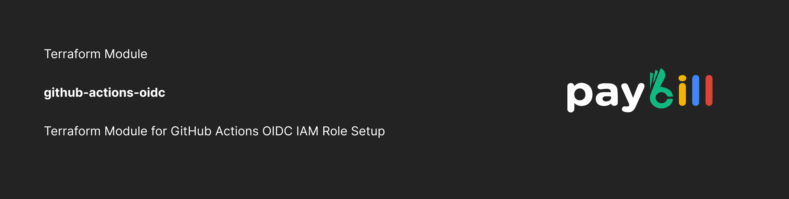

<p align="center">
  <a href="https://paybill.dev" target="_blank">
    <picture>
      
    </picture>
  </a>
</p>

## GitHub Actions OIDC IAM Role Module

This module configures **secure, keyless authentication between GitHub Actions and AWS** using OpenID Connect (OIDC). It enables a specific GitHub repository and branch to assume an AWS IAM role without requiring long-lived AWS access keys.

The module optionally creates (or reuses) the GitHub Actions OIDC provider in the AWS account, defines a tightly scoped trust policy, and attaches configurable IAM permissions to the role. It also stores GitHub metadata securely in AWS SSM Parameter Store for use by other platform components.

### Key Features

* Creates or reuses an AWS IAM **OIDC provider** for GitHub Actions
* Defines a **branch- and repository-restricted** trust policy
* Provisions an IAM role assumable via `sts:AssumeRoleWithWebIdentity`
* Attaches a configurable IAM policy (S3 access by default)
* Stores GitHub configuration values securely in **SSM Parameter Store**
* Eliminates the need for long-lived AWS credentials in CI/CD pipelines

### Use Cases

* Deploying infrastructure from GitHub Actions
* Uploading build artifacts to S3
* Running environment-scoped CI/CD workflows
* Enforcing least-privilege access for GitHub-based automation

### Security Model

Access is limited to:

* A specific GitHub **organization/user**
* A specific **repository**
* A specific **branch**
* The official GitHub Actions OIDC provider

Only workflows that match these conditions can assume the IAM role.

### **Setup Github account access**
[Generate Github Token](https://docs.github.com/en/authentication/keeping-your-account-and-data-secure/managing-your-personal-access-tokens) and store them in ssm parameter as `SecureString`. (using parameter name - /{namespace}/{environment}/github_user & /{namespace}/{environment}/github_token)

Create a [codepipeline connection for github](https://docs.aws.amazon.com/codepipeline/latest/userguide/connections-github.html) with your github account and repository named `github-connection-paybill` or run this terraform.

* Create `terraform.tfvars` 

```hcl
github_user    = "change-me"
github_repo    = "change-me"
github_token   = "change-me"
```

* Then run the following command to deploy it 

    ```
    terraform init
    terraform plan 
    terraform apply
    ```
* Unfortunately, Terraform **cannot create the actual GitHub connection** (because you need to authorize GitHub OAuth via the AWS Console).
You must first create it in the console:
    * Go to **AWS Console → Developer Tools → Connections**
    * Click **Create connection** → Select **GitHub** → **Install App / Authorize**.

---
<!-- BEGIN_TF_DOCS -->
## Requirements

No requirements.

## Providers

| Name | Version |
|------|---------|
| <a name="provider_aws"></a> [aws](#provider\_aws) | n/a |
| <a name="provider_tls"></a> [tls](#provider\_tls) | n/a |

## Modules

No modules.

## Resources

| Name | Type |
|------|------|
| [aws_iam_openid_connect_provider.github_actions](https://registry.terraform.io/providers/hashicorp/aws/latest/docs/resources/iam_openid_connect_provider) | resource |
| [aws_iam_policy.github_actions_policy](https://registry.terraform.io/providers/hashicorp/aws/latest/docs/resources/iam_policy) | resource |
| [aws_iam_role.github_actions_role](https://registry.terraform.io/providers/hashicorp/aws/latest/docs/resources/iam_role) | resource |
| [aws_iam_role_policy_attachment.attach_policy](https://registry.terraform.io/providers/hashicorp/aws/latest/docs/resources/iam_role_policy_attachment) | resource |
| [aws_ssm_parameter.github_branch](https://registry.terraform.io/providers/hashicorp/aws/latest/docs/resources/ssm_parameter) | resource |
| [aws_ssm_parameter.github_repo](https://registry.terraform.io/providers/hashicorp/aws/latest/docs/resources/ssm_parameter) | resource |
| [aws_ssm_parameter.github_token](https://registry.terraform.io/providers/hashicorp/aws/latest/docs/resources/ssm_parameter) | resource |
| [aws_ssm_parameter.github_user](https://registry.terraform.io/providers/hashicorp/aws/latest/docs/resources/ssm_parameter) | resource |
| [aws_caller_identity.this](https://registry.terraform.io/providers/hashicorp/aws/latest/docs/data-sources/caller_identity) | data source |
| [aws_iam_openid_connect_provider.github_actions](https://registry.terraform.io/providers/hashicorp/aws/latest/docs/data-sources/iam_openid_connect_provider) | data source |
| [aws_iam_policy_document.github_actions_assume_role](https://registry.terraform.io/providers/hashicorp/aws/latest/docs/data-sources/iam_policy_document) | data source |
| [aws_iam_policy_document.github_actions_permissions](https://registry.terraform.io/providers/hashicorp/aws/latest/docs/data-sources/iam_policy_document) | data source |
| [tls_certificate.oidc_thumbprint](https://registry.terraform.io/providers/hashicorp/tls/latest/docs/data-sources/certificate) | data source |

## Inputs

| Name | Description | Type | Default | Required |
|------|-------------|------|---------|:--------:|
| <a name="input_create_oidc_provider"></a> [create\_oidc\_provider](#input\_create\_oidc\_provider) | n/a | `bool` | `true` | no |
| <a name="input_environment"></a> [environment](#input\_environment) | Name of the environment, i.e. dev, stage, prod | `string` | `"dev"` | no |
| <a name="input_github_branch"></a> [github\_branch](#input\_github\_branch) | GitHub branch name (e.g., main) | `string` | `"main"` | no |
| <a name="input_github_repo"></a> [github\_repo](#input\_github\_repo) | GitHub repository name | `string` | n/a | yes |
| <a name="input_github_token"></a> [github\_token](#input\_github\_token) | GitHub user/organization that has been generated | `string` | n/a | yes |
| <a name="input_github_user"></a> [github\_user](#input\_github\_user) | GitHub user/organization that will access AWS via OIDC | `string` | n/a | yes |
| <a name="input_iam_role_name"></a> [iam\_role\_name](#input\_iam\_role\_name) | Name of the IAM role for GitHub Actions | `string` | `"github-actions-role"` | no |
| <a name="input_namespace"></a> [namespace](#input\_namespace) | Namespace of the project | `string` | `"platform-api"` | no |
| <a name="input_policy_name"></a> [policy\_name](#input\_policy\_name) | Name of the IAM policy for GitHub Actions | `string` | `"github-actions-policy"` | no |
| <a name="input_s3_buckets"></a> [s3\_buckets](#input\_s3\_buckets) | List of S3 bucket ARNs the GitHub Actions role can access | `list(string)` | <pre>[<br/>  "*"<br/>]</pre> | no |

## Outputs

No outputs.
<!-- END_TF_DOCS -->